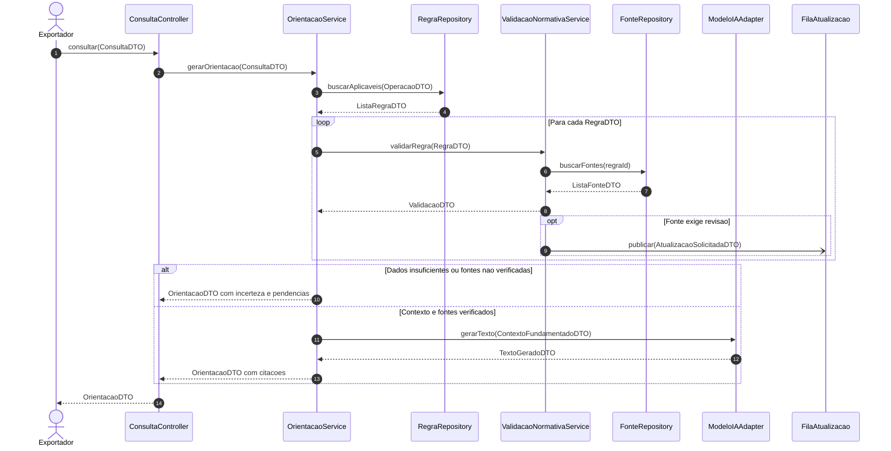
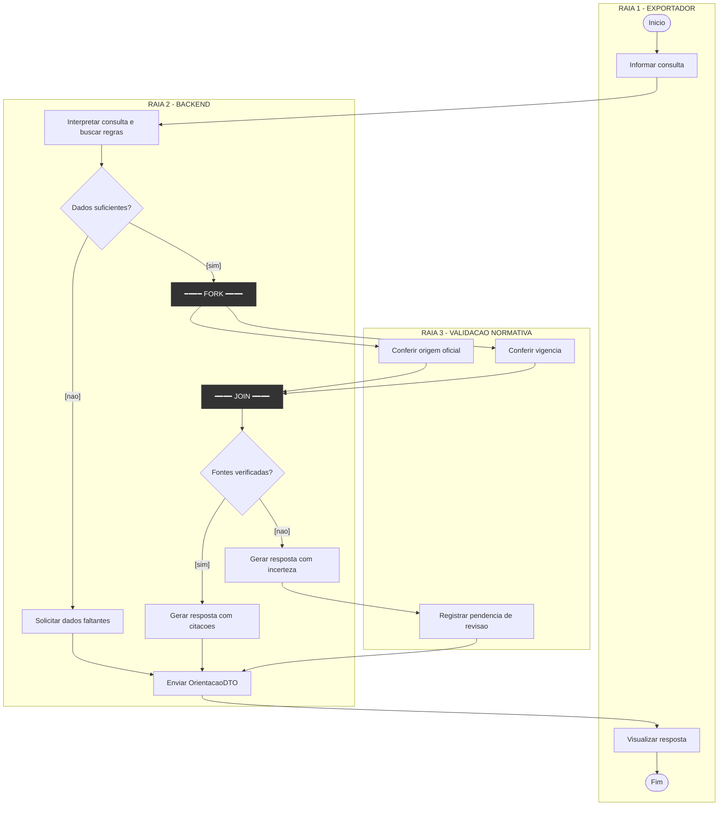
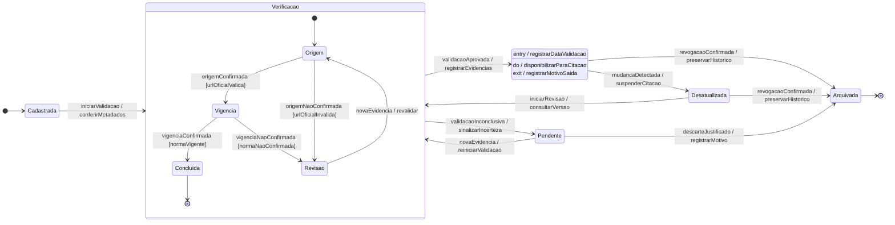
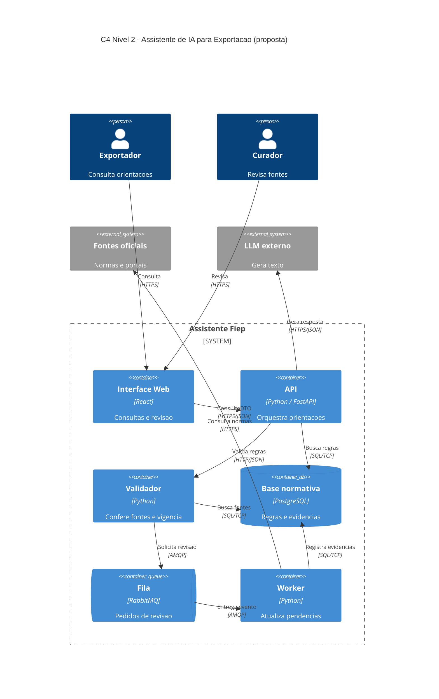

# Dossiê de Arquitetura Viva — Assistente de IA para Exportação (Fiep)

**Funcionalidade:** validação e rastreabilidade das fontes normativas.  
**Requisitos:** RF10 (citações), RF11 (incerteza) e RF12 (atualização regulatória).

## Objetivo
Modelar como o assistente consulta regras aduaneiras, verifica suas fontes oficiais, comunica incertezas e registra pendências de atualização. O material é uma **proposta arquitetural acadêmica**, baseada nos requisitos, na visão de domínio e nos diagramas de classes anexados.

## 1. Diagrama de sequência
Mostra as chamadas síncronas, o envio assíncrono de eventos, os DTOs e o tratamento alternativo de fontes não verificadas.



[Arquivo Mermaid](docs/diagrams/sequencia.mmd)

**Operações públicas propostas (receptor → método):** `ConsultaController.consultar(ConsultaDTO)`; `OrientacaoService.gerarOrientacao(ConsultaDTO)`; `RegraRepository.buscarAplicaveis(OperacaoDTO)`; `ValidacaoNormativaService.validarRegra(RegraDTO)`; `FonteRepository.buscarFontes(regraId)`; `ModeloIAAdapter.gerarTexto(ContextoFundamentadoDTO)`; `FilaAtualizacao.publicar(AtualizacaoSolicitadaDTO)`. Os retornos são `OrientacaoDTO`, `ListaRegraDTO`, `ValidacaoDTO`, `ListaFonteDTO` e `TextoGeradoDTO`, conforme as setas. A chamada inicial `consultar` representa a API exposta ao exportador. Essas operações complementam o modelo de classes existente e precisam ser declaradas publicamente na implementação.

## 2. Diagrama de atividades
Três raias mostram a consulta, a validação paralela de origem e vigência e os caminhos mutuamente exclusivos. Mermaid usa `subgraph` como aproximação visual de raias UML; as barras Fork/Join são representadas explicitamente.



[Arquivo Mermaid](docs/diagrams/atividades.mmd)

## 3. Diagrama de estados
A entidade `FonteNormativa` passa por cadastro, verificação, revisão e arquivamento. O estado de verificação contém subestados; `Verificada` tem ações internas.



[Arquivo Mermaid](docs/diagrams/estados.mmd)

## 4. C4 — Contêineres (Nível 2)
Apresenta a interface, API, validador, banco, fila e worker, com tecnologias e protocolos **propostos**.



[Arquivo Mermaid](docs/architecture/workspace.mmd)

## 5. ADR 0001
A [decisão arquitetural](docs/architecture/adr-0001.md) propõe validar as fontes separadamente do LLM e registrar atualizações para revisão humana.

## Rastreabilidade

| Requisito | Atendimento |
|---|---|
| **RF10** | Fonte oficial, referência legal e citação na resposta |
| **RF11** | Resposta com ressalvas quando faltam dados ou validação |
| **RF12** | Evento assíncrono, revisão e revalidação de fontes |

## Estrutura

```text
aps3-nome-sobrenome/
├── README.md
└── docs/
    ├── architecture/
    │   ├── workspace.mmd
    │   └── adr-0001.md
    └── diagrams/
        ├── sequencia.mmd
        ├── atividades.mmd
        └── estados.mmd
```

**Observações:** a verificação de fonte não equivale a parecer jurídico. A infraestrutura (React, FastAPI, PostgreSQL e RabbitMQ) é ilustrativa e deve ser confirmada com a equipe. Para visualizar os diagramas, use GitHub ou um editor compatível com Mermaid, incluindo C4.
